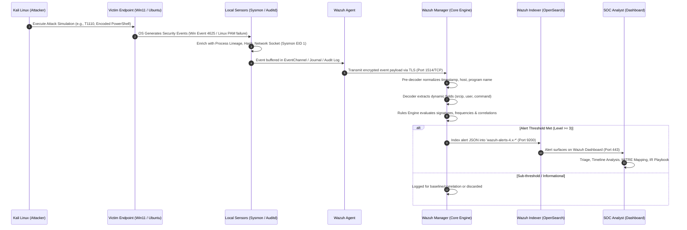

# End-to-End Security Data Flow & Telemetry Lifecycle

## 1. Security Telemetry Pipeline

---

## 2. Stage-by-Stage Breakdown

### Stage 1: Adversary Simulation (Adversary Activity)
- An adversary action is simulated from `lab-attacker` (`192.168.56.10`).
- Examples: Hydra password spray against SSH on `192.168.56.30`, or PowerShell command execution with `-EncodedCommand` on `192.168.56.20`.
- The activity generates kernel and user-space artifacts on the target system.

### Stage 2: Endpoint Telemetry Capture (Host Sensing)
- **Windows 11 (`192.168.56.20`)**:
  - `Security.evtx`: Records native authentication events (Event ID `4625` Logon Failure, `4624` Logon Success, `4720` User Creation, `4728` Group Membership).
  - `Microsoft-Windows-Sysmon/Operational.evtx`: Captures deep contextual data:
    - Event ID 1: Process Creation (CommandLine, CurrentDirectory, ParentCommandLine, ParentProcessId, Hashes).
    - Event ID 3: Network Connection (SourceIp, DestinationIp, DestinationPort, Process).
    - Event ID 11: File Create (TargetFilename, Hashes).
- **Ubuntu Server (`192.168.56.30`)**:
  - `/var/log/auth.log`: Records SSH authentication attempts, PAM module results, and `sudo` privilege escalations.
  - `/var/log/audit/audit.log` (`auditd`): Kernel-level syscall monitoring (e.g., execution of discovery commands `uname`, `whoami`, `id`, file modifications on `/etc/shadow`).

### Stage 3: Ingestion & Transmission (Agent Transport)
- The local **Wazuh Agent** runs as a daemon (`wazuh-agent` service):
  - On Windows: Uses the `win_eventchannel` input plugin to read events directly from Windows Event Channels via official Windows APIs.
  - On Linux: Reads from structured log files (`/var/log/auth.log`), audit daemon outputs, and FIM (`syscheck`) monitoring queues.
- Events are buffered locally in memory (with disk spooling on connection drops) and transmitted over a secure TLS session on port **1514/TCP** to `192.168.56.40`.

### Stage 4: Decoding & Normalization (Manager Ingestion)
- **Pre-decoding**: The Wazuh Manager parses standard RFC header components (timestamp, hostname, daemon name).
- **Decoding**: The event body is matched against XML decoders (e.g., `sysmon`, `sshd`, `pam`, `windows_eventchannel`). Dynamic fields are populated:
  - `data.win.eventdata.image`
  - `data.win.eventdata.commandLine`
  - `data.srcip`
  - `data.dstuser`

### Stage 5: Rule Engine Evaluation & Correlation (Detection Logic)
- The Manager's `analysisd` engine passes decoded fields through the hierarchical ruleset:
  1. **Atomic Rules**: Match specific field patterns (e.g., Rule ID `100010`: Sysmon Event ID 1 where command line contains `-EncodedCommand`).
  2. **Frequency Rules**: Group matching events over a rolling time window (e.g., Rule ID `100001`: If 10 authentication failures occur within 60 seconds from the same `srcip`, trigger Level 10 alert).
  3. **Multi-Event Correlation**: Chain multiple rule IDs across time (e.g., Rule ID `100002`: Trigger when a successful authentication follows Rule ID `100001` within 5 minutes).

### Stage 6: Indexing & Storage
- Alerts with severity Level 3 and above are serialized into structured JSON and indexed into OpenSearch via the Wazuh Indexer (`wazuh-alerts-4.x-*`).
- Full raw logs can optionally be archived to `/var/ossec/logs/archives/archives.json` for compliance and non-alert auditing.

### Stage 7: Analyst Triage & Response (SOC Operations)
- The SOC Analyst connects to the Wazuh Dashboard at `https://192.168.56.40:443`.
- The analyst extracts the event timeline, confirms the affected asset, evaluates IOCs (source IP, command lines, hashes), rules out false positives, maps the activity to the MITRE ATT&CK Matrix, and initiates the incident response playbook.
