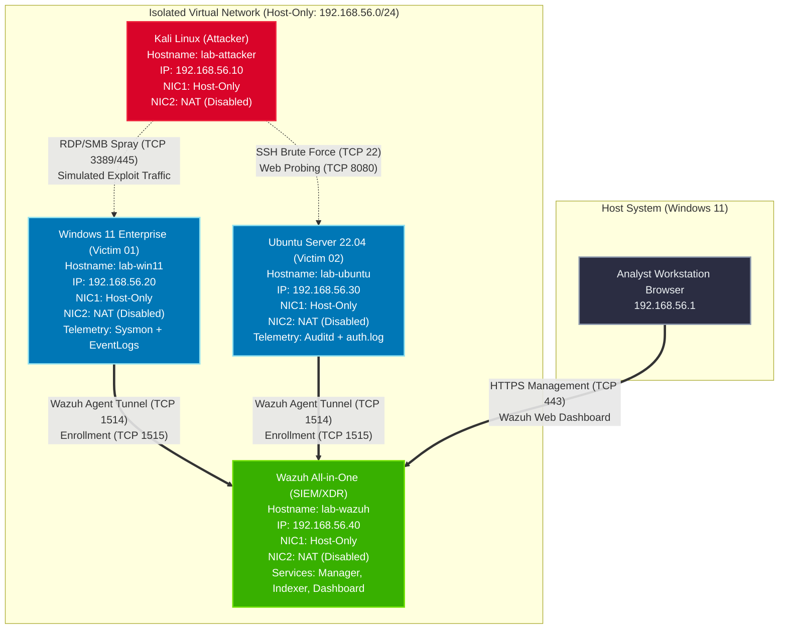

# Network Architecture & Isolation Topology

## 1. Network Topology Diagram



---

## 2. Network Segmentation & Firewall Policy Matrix

The following matrix documents the allowed inter-node network flows within the lab. Any traffic outside these designated flows is considered extraneous:

```text
┌─────────────────┬─────────────────┬─────────────────────┬──────────────┬────────────────────────────────────────────┐
│ Source Node     │ Target Node     │ Destination Port(s) │ Protocol     │ Purpose                                    │
├─────────────────┼─────────────────┼─────────────────────┼──────────────┼────────────────────────────────────────────┤
│ Host (192.168.56.1) │ Wazuh (.40) │ 443                 │ TCP (HTTPS)  │ SOC Analyst Web Dashboard access           │
│ Host (192.168.56.1) │ Ubuntu (.30)│ 22                  │ TCP (SSH)    │ Administrative lab management              │
│ Host (192.168.56.1) │ Win11 (.20) │ 3389                │ TCP (RDP)    │ Administrative lab management              │
│ Windows (.20)   │ Wazuh (.40)     │ 1514, 1515          │ TCP          │ Wazuh Agent telemetry & enrollment         │
│ Ubuntu (.30)    │ Wazuh (.40)     │ 1514, 1515          │ TCP          │ Wazuh Agent telemetry & enrollment         │
│ Kali (.10)      │ Ubuntu (.30)    │ 22, 8080            │ TCP          │ Attack simulation (SSH Brute Force, Web)   │
│ Kali (.10)      │ Windows (.20)   │ 445, 3389, 5985     │ TCP          │ Attack simulation (Auth Spray, SMB, WinRM) │
│ Kali (.10)      │ Wazuh (.40)     │ NONE (Blocked)      │ -            │ SIEM infrastructure must remain untouched  │
└─────────────────┴─────────────────┴─────────────────────┴──────────────┴────────────────────────────────────────────┘
```

---

## 3. Network Isolation Mechanics

### VirtualBox Host-Only Adapter Configuration
- **Interface Name**: `VirtualBox Host-Only Ethernet Adapter` (`vboxnet0` on Linux hosts)
- **IPv4 Address**: `192.168.56.1`
- **Subnet Mask**: `255.255.255.0` (`/24`)
- **DHCP Server**: **Disabled**. All lab systems must utilize deterministic, static IP configurations to prevent IP drift across test runs.

### Dual-NIC Safeguard Command Reference
To ensure total isolation during attack execution, verify and disable the secondary NAT interfaces on all lab VMs:

```powershell
# Verify network status of lab VMs in PowerShell
& "C:\Program Files\Oracle\VirtualBox\VBoxManage.exe" list runningvms

# Disconnect the Internet NAT adapter (Adapter 2) while keeping Host-Only (Adapter 1) active
& "C:\Program Files\Oracle\VirtualBox\VBoxManage.exe" controlvm "lab-attacker" setlinkstate2 off
& "C:\Program Files\Oracle\VirtualBox\VBoxManage.exe" controlvm "lab-win11" setlinkstate2 off
& "C:\Program Files\Oracle\VirtualBox\VBoxManage.exe" controlvm "lab-ubuntu" setlinkstate2 off
& "C:\Program Files\Oracle\VirtualBox\VBoxManage.exe" controlvm "lab-wazuh" setlinkstate2 off
```

To reconnect Adapter 2 temporarily for repository updates or package installation:

```powershell
& "C:\Program Files\Oracle\VirtualBox\VBoxManage.exe" controlvm "<VM_NAME>" setlinkstate2 on
```
